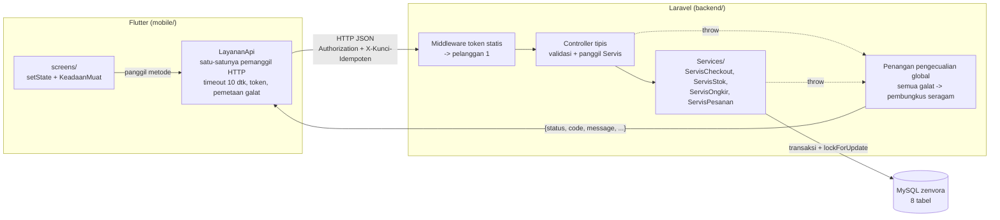
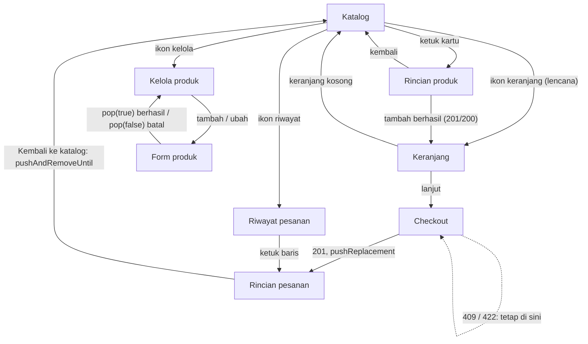

# Arsitektur — Zenvora

> Pendamping `prd.md`, `database-schema.md`, dan `api-contract.md`. Dokumen ini menjawab: **kode diletakkan di mana, siapa memanggil siapa, dan mengapa dirancang begitu.** Bila bertentangan, kontrak (`api-contract.md`) menang untuk bentuk respons, skema (`database-schema.md`) menang untuk tabel.
> Isi kerangka kode di sini adalah **rancangan**, bukan salinan final; tulis ulang dan pahami sendiri (aturan AI: setiap anggota harus bisa menjelaskan tiap baris).

---

## 1. Gambaran Komponen



Pembagian tanggung jawab (selaras PDF tugas Bagian 4):

| Lapisan | Mengerjakan | Dilarang |
|---------|-------------|----------|
| MySQL | Menyimpan produk, unit, keranjang, pesanan, detail, kurir | Total sebagai satu-satunya sumber tanpa detail per item |
| Laravel | Validasi, subtotal, berat, ongkir, total, stok/unit, perpindahan status, idempotensi | Membalas HTML atau galat mentah basis data |
| Flutter | Menampilkan, mengirim permintaan, `KeadaanMuat`, menampilkan galat | Menghitung harga, total, ongkir, atau ketersediaan |

Aturan emas: **bila sebuah angka tampil di layar, angka itu sudah ada di JSON.** Tidak ada `+`, `*`, `/`, `reduce`, atau `ceil` pada nilai uang/berat/stok di `mobile/lib`.

---

## 2. Struktur Folder

### 2.1 `backend/` (Laravel, dibuat dengan `composer create-project laravel/laravel backend`)

```
backend/
├── app/
│   ├── Enums/
│   │   └── StatusPesanan.php          # 7 nilai + bolehPindahKe() + berikutnya()
│   ├── Exceptions/
│   │   ├── BentrokException.php       # -> 409, membawa message + data opsional
│   │   └── TokenTidakValidException.php # -> 401
│   ├── Http/
│   │   ├── Controllers/Api/
│   │   │   ├── ProdukController.php
│   │   │   ├── KeranjangController.php
│   │   │   ├── KurirController.php
│   │   │   ├── MetodePembayaranController.php
│   │   │   ├── CheckoutController.php
│   │   │   └── PesananController.php  # index, show, ubahStatus
│   │   ├── Middleware/
│   │   │   └── AutentikasiTokenStatis.php
│   │   ├── Requests/                  # pesan validasi berbahasa Indonesia
│   │   │   ├── SimpanProdukRequest.php
│   │   │   ├── TambahKeranjangRequest.php
│   │   │   ├── UbahKeranjangRequest.php
│   │   │   ├── CheckoutRequest.php
│   │   │   └── UbahStatusRequest.php
│   │   └── Resources/                 # bentuk JSON sesuai api-contract Bagian 2
│   │       ├── ProdukResource.php
│   │       ├── ItemKeranjangResource.php
│   │       ├── KurirResource.php
│   │       ├── RingkasanPesananResource.php
│   │       └── RincianPesananResource.php
│   ├── Models/                        # SETIAP model: protected $table = '...'
│   │   ├── Pelanggan.php  Produk.php (SoftDeletes)  UnitProduk.php  Keranjang.php
│   │   └── Kurir.php  MetodePembayaran.php  Pesanan.php  DetailPesanan.php
│   ├── Services/
│   │   ├── ServisCheckout.php         # satu-satunya tempat zona transaksi checkout
│   │   ├── ServisStok.php             # buat/tambah/hapus unit, sinkron produk.stok
│   │   ├── ServisOngkir.php           # hitung berat, kg tertagih, ongkir, total
│   │   └── ServisPesanan.php          # ubah status + pengembalian unit saat batal
│   └── Support/
│       └── Respons.php                # sukses($data,$pesan,$kode) dan gagal(...)
├── bootstrap/app.php                  # routing api + withExceptions (penangan global)
├── config/zenvora.php                 # daftar kategori, token pembeli, flag demo galat
├── database/migrations/               # urutan di database-schema.md Bagian 3
├── database/seeders/                  # Pelanggan, Kurir, MetodePembayaran, Produk(+unit), PesananContoh
├── routes/api.php                     # 15 rute; dibuat lewat `php artisan install:api`
└── .env.example                       # tanpa kata sandi asli
```

Catatan penting:

- Laravel 11+ tidak membawa `routes/api.php` secara bawaan. Jalankan `php artisan install:api` atau buat berkasnya sendiri dan daftarkan di `bootstrap/app.php`. Paket Sanctum yang ikut terpasang tidak dipakai; token statis ditangani middleware sendiri (cukup 15 baris, mudah dijelaskan).
- `JsonResource::withoutWrapping()` dipanggil sekali supaya Resource tidak menambah kunci `data` sendiri; pembungkus tunggal dibentuk `Respons`.
- Paginasi lazy load memakai `skip(($halaman-1)*$per)->take($per)` biasa, **bukan** `paginate()`, karena `paginate()` menambah kunci `links/meta` yang melanggar pembungkus seragam.
- Pengontrol tipis: validasi (Request) → panggil Servis → bungkus (Respons). Aturan bisnis tidak ditulis di controller.

### 2.2 `mobile/lib/` (Flutter, paket `http`, tanpa Provider)

```
mobile/lib/
├── main.dart                          # MaterialApp, rute awal = KatalogPage
├── config/
│   └── konfigurasi.dart               # const alamatServer, const tokenStatis, const batasWaktu
├── enums/
│   └── keadaan_muat.dart              # enum KeadaanMuat { memuat, berhasil, kosong, galat }
├── exceptions/
│   └── galat_api.dart                 # SambunganGagal, BatasWaktu, Validasi, Bentrok,
│                                      # TidakDitemukan, Server (turunan GalatApi)
├── models/                            # fromJson saja; tanpa logika hitung
│   ├── produk.dart  item_keranjang.dart  keranjang.dart  kurir.dart
│   ├── metode_pembayaran.dart  ringkasan_pesanan.dart  rincian_pesanan.dart
├── services/
│   └── layanan_api.dart               # SEMUA panggilan HTTP + pemetaan galat
├── screens/
│   ├── katalog_page.dart  rincian_produk_page.dart  keranjang_page.dart
│   ├── checkout_page.dart  rincian_pesanan_page.dart  riwayat_pesanan_page.dart
│   ├── kelola_produk_page.dart  form_produk_page.dart
└── widgets/
    ├── tampilan_galat.dart            # pesan + tombol Coba lagi sesuai jenis galat
    ├── tampilan_kosong.dart           # keterangan + saran langkah
    ├── kartu_produk.dart  lencana_keranjang.dart  penanda_habis.dart
```

Aturan berkas: satu kelas publik utama per berkas, nama berkas `snake_case`, nama kelas `PascalCase`, identifier Indonesia (selaras `conventions.md`).

---

## 3. Alur Checkout (zona kritis)

### 3.1 Diagram urutan

```mermaid
sequenceDiagram
    autonumber
    participant F as Flutter (CheckoutPage)
    participant L as LayananApi
    participant S as Laravel (CheckoutController)
    participant V as ServisCheckout
    participant D as MySQL

    F->>F: tombol dimatikan; kunci dibuat sekali bila belum ada
    F->>L: checkout(kunci, kurir, metode, nama, alamat)
    L->>S: POST /api/checkout + X-Kunci-Idempoten (timeout 10 dtk)
    S->>S: header kunci ada? (tidak: 422)
    S->>D: pesanan dengan (pelanggan, kunci) sudah ada?
    alt sudah ada (replay)
        D-->>S: pesanan lama
        S-->>L: 201 + pesanan yang sama
    else belum ada
        S->>S: validasi body + keranjang tidak kosong (gagal: 422)
        S->>V: proses()
        V->>D: BEGIN
        V->>D: SELECT produk ... ORDER BY id FOR UPDATE
        V->>D: cek ulang replay (kunci sama sudah commit?)
        V->>D: baca keranjang, hitung unit tersedia
        alt stok/tersedia kurang
            V->>D: ROLLBACK
            V-->>S: BentrokException(item_kurang)
            S-->>L: 409 + data.item_kurang
        else cukup
            V->>D: unit tersedia -> terjual, produk.stok dikurangi
            V->>D: INSERT pesanan + detail_pesanan (salinan harga/berat/garansi)
            V->>D: UPDATE nomor_pesanan, unit.detail_pesanan_id
            V->>D: DELETE keranjang pelanggan
            V->>D: COMMIT
            V-->>S: Pesanan
            S-->>L: 201 + rincian pesanan
        end
    end
    L-->>F: RincianPesanan atau GalatApi bertipe
    F->>F: sukses: pindah ke Rincian pesanan; gagal: tampil galat, tombol aktif lagi
```

Jaringan putus setelah `COMMIT` (balasan tidak sampai): Flutter melihat galat sambungan/batas waktu, pengguna menekan **Coba lagi** dengan kunci **sama**, server menemukan pesanan lama dan membalasnya (ini jawaban uji petik C4).

### 3.2 Kerangka `ServisCheckout::proses()` (RANCANGAN)

```php
public function proses(Pelanggan $pelanggan, string $kunci, array $data): Pesanan
{
    // Langkah 2 kontrak (replay) dilakukan di controller sebelum validasi body/keranjang.
    return DB::transaction(function () use ($pelanggan, $kunci, $data) {

        $keranjang = Keranjang::where('pelanggan_id', $pelanggan->id)->orderBy('produk_id')->get();
        $idProduk  = $keranjang->pluck('produk_id')->sort()->values();

        // Kunci baris produk, SELALU urut id naik (mencegah deadlock antar dua checkout)
        $produk = Produk::whereIn('id', $idProduk)->orderBy('id')->lockForUpdate()->get()->keyBy('id');

        // Cek replay lagi: permintaan kembar mungkin sudah commit selagi kita menunggu kunci
        if ($lama = Pesanan::where('pelanggan_id', $pelanggan->id)->where('kunci_idempoten', $kunci)->first()) {
            return $lama;
        }

        // Periksa semua item dulu, kumpulkan yang kurang, baru lempar SEKALI
        $kurang = [];
        foreach ($keranjang as $baris) {
            $p = $produk[$baris->produk_id] ?? null;
            $tersedia = $p ? UnitProduk::where('produk_id', $p->id)->where('status', 'tersedia')->count() : 0;
            if (!$p || !$p->tersedia || $tersedia < $baris->jumlah) {
                $kurang[] = ['produk_id' => $baris->produk_id, 'nama' => $p?->nama,
                             'diminta' => $baris->jumlah, 'tersedia' => $p?->tersedia ? $tersedia : 0];
            }
        }
        if ($kurang) {
            throw new BentrokException('Stok beberapa barang tidak mencukupi', ['item_kurang' => $kurang]);
        }

        $hitung = $this->servisOngkir->hitung($keranjang, $produk, $data['kurir_id']); // semua uang/berat di sini

        $pesanan = Pesanan::create([ /* pelanggan, kurir, metode, status awal, penerima,
                                        subtotal, berat, kg, tarif_saat_pesan, ongkir, total, kunci */ ]);
        $pesanan->update(['nomor_pesanan' => sprintf('ZNV-%s-%05d', now()->format('Ymd'), $pesanan->id)]);

        foreach ($keranjang as $baris) {
            $detail = DetailPesanan::create([ /* salinan nama, harga, berat, garansi, jumlah, subtotal_item */ ]);
            $this->servisStok->jual($produk[$baris->produk_id], $baris->jumlah, $detail); // unit -> terjual, stok -N
        }

        Keranjang::where('pelanggan_id', $pelanggan->id)->delete();
        return $pesanan->load('detail.unit', 'kurir', 'metodePembayaran');
    });
}
```

Hal yang harus bisa dijelaskan tiap anggota:

| Pertanyaan | Jawaban singkat | Letak |
|------------|-----------------|-------|
| Mengapa kunci urut `id` naik? | Dua checkout yang mengunci produk dengan urutan berlawanan bisa saling menunggu selamanya (deadlock) | `orderBy('id')->lockForUpdate()` |
| Dua pembeli, unit terakhir? | Pembeli pertama memegang kunci; pembeli kedua menunggu, lalu melihat unit tersedia sudah 0, balas 409; stok tidak minus | blok pemeriksaan + `lockForUpdate` |
| Proses mati setelah stok dikurangi? | Transaksi belum commit, MySQL rollback otomatis, stok utuh | `DB::transaction` |
| Mengapa harga disalin ke detail? | Pesanan lama tidak berubah saat produk diedit | `DetailPesanan::create` |
| Mengapa `ServisOngkir` terpisah? | Rumus yang sama dipakai `GET /api/kurir` (estimasi) dan checkout (final); satu rumus, satu tempat | `Services/ServisOngkir.php` |

---

## 4. Penangan Galat Backend → Pembungkus Seragam

Semua pemetaan di **satu tempat**: `bootstrap/app.php` → `withExceptions(...)`, memakai `Respons::gagal()`. Untuk jalur `api/*` selalu balas JSON (`$exceptions->shouldRenderJsonWhen(fn ($req) => $req->is('api/*'))`).

| Sumber galat | Kode | Pesan (contoh) | Catatan |
|--------------|:----:|----------------|---------|
| `ValidationException` | 422 | "Data yang dikirim tidak lengkap" | `errors` = `{kolom: [pesan]}` |
| `BentrokException` | 409 | pesan dari Servis | `data` hanya bila diisi (`item_kurang`) |
| `TokenTidakValidException` | 401 | "Token tidak valid" | dari middleware |
| `ModelNotFoundException`, `NotFoundHttpException` | 404 | "Data tidak ditemukan" | juga rute tak ada |
| `MethodNotAllowedHttpException` | 405 | "Metode tidak diizinkan" | tetap pembungkus |
| `QueryException`, `Throwable` lain | 500 | "Terjadi kesalahan pada server" | detail hanya ke `storage/logs`, **tidak** ke respons |

`code` selalu `(string)`. Pada 500, jangan pernah mengirim `$e->getMessage()`.

---

## 5. Arsitektur Flutter

### 5.1 Aliran data

```
Widget (screens/)  --panggil-->  LayananApi  --http+timeout-->  Laravel
      ^                                |
      |  Future<Model> / lempar GalatApi bertipe
      +--------------------------------+
Halaman: setState(_keadaan = ..., _galat = ...)  ->  build() hanya MEMBACA field
```

Tidak ada singleton global, tidak ada Provider. Data berpindah lewat constructor (turun) dan callback (naik), sesuai materi sampai Pertemuan 6.

### 5.2 `LayananApi` (RANCANGAN kerangka)

```dart
class LayananApi {
  Map<String, String> _header({String? kunciIdempoten}) => {
        'Accept': 'application/json',
        'Content-Type': 'application/json',
        'Authorization': 'Bearer $tokenStatis',      // SATU-SATUNYA tempat token dikirim
        if (kunciIdempoten != null) 'X-Kunci-Idempoten': kunciIdempoten,
      };

  Future<dynamic> _kirim(Future<http.Response> Function() permintaan) async {
    http.Response respons;
    try {
      respons = await permintaan().timeout(batasWaktu);
    } on TimeoutException {
      throw BatasWaktuException();
    } on SocketException {
      throw SambunganGagalException();
    } on http.ClientException {
      throw SambunganGagalException();
    }

    Map<String, dynamic> badan;
    try {
      badan = jsonDecode(utf8.decode(respons.bodyBytes)) as Map<String, dynamic>;
    } on FormatException {
      throw ServerException();                       // HTML / bukan JSON = galat server
    }

    final kode = int.tryParse('${badan['code']}') ?? respons.statusCode;
    if (badan['status'] == 'sukses') return badan['data'];

    final pesan = badan['message'] as String? ?? 'Terjadi kesalahan';
    switch (kode) {
      case 422: throw ValidasiException(pesan, _kePetaKolom(badan['errors']));
      case 409: throw BentrokException(pesan, badan['data']);
      case 404: throw TidakDitemukanException(pesan);
      default:  throw ServerException();             // 401, 500, lainnya: pesan umum
    }
  }

  Future<List<Produk>> daftarProduk({String? kategori, String? cari, int halaman = 1, int perHalaman = 10}) =>
      _kirim(() => http.get(_uri('/produk', {...}), headers: _header()))
          .then((d) => (d as List).map((j) => Produk.fromJson(j)).toList());
  // ... satu metode per endpoint (15 metode), semuanya lewat _kirim
}
```

Catatan teknis:

- **Mode pesawat biasanya menghasilkan `SocketException` (sambungan gagal), bukan timeout.** Itulah sebabnya kedua galat harus dibedakan dari pemicunya masing-masing (lihat Bagian 8).
- Satu `_kirim` untuk semua endpoint → satu fungsi pembaca pembungkus (sesuai alasan PDF mewajibkan pembungkus seragam; jawaban uji petik B6).
- Model Dart hanya `fromJson`. `deskripsi` bertipe `String?`; tampilan: `produk.deskripsi ?? 'Belum ada deskripsi'`.

### 5.3 Pola halaman standar (4 keadaan)

```dart
class _KatalogPageState extends State<KatalogPage> {
  KeadaanMuat _keadaan = KeadaanMuat.memuat;
  GalatApi? _galat;
  List<Produk> _produk = [];

  @override
  void initState() { super.initState(); _muat(); }           // tidak ada jaringan di build()

  Future<void> _muat() async {
    setState(() => _keadaan = KeadaanMuat.memuat);
    try {
      final hasil = await _layanan.daftarProduk(kategori: _kategori, cari: _cari);
      if (!mounted) return;                                  // cegah setState setelah halaman ditutup
      setState(() { _produk = hasil; _keadaan = hasil.isEmpty ? KeadaanMuat.kosong : KeadaanMuat.berhasil; });
    } on GalatApi catch (e) {
      if (!mounted) return;
      setState(() { _galat = e; _keadaan = KeadaanMuat.galat; });
    }
  }
  // build(): switch (_keadaan) -> CircularProgressIndicator | ListView.builder/GridView.builder
  //                              | TampilanKosong | TampilanGalat(galat: _galat!, onCoba: _muat)
}
```

`catch` selalu menangkap tipe bertipe (`on GalatApi`), tidak pernah kosong, tidak pernah menampilkan `e.toString()`.

### 5.4 Pemetaan galat → tampilan (5 jenis, harus berbeda)

| Jenis | Pengecualian | Di halaman daftar/detail | Di form/aksi |
|-------|--------------|--------------------------|--------------|
| Tanpa sambungan | `SambunganGagalException` | `TampilanGalat`: ikon wifi putus + "Koneksi Terputus" + "Tidak dapat terhubung ke server" + **Coba Lagi** | sama, di tempat aksi |
| Batas waktu | `BatasWaktuException` | `TampilanGalat`: ikon timer mati + "Waktu Permintaan Habis" + "Server tidak membalas" + **Coba Lagi** | sama |
| 422 | `ValidasiException` | tidak umum | pesan per kolom di bawah `TextFormField` (`errorText` dari `errors[kolom]`) |
| 409 | `BentrokException` | tidak umum | pesan **dari server** di layar yang sama (banner/SnackBar), tanpa `Navigator.push` |
| 500 / tak terbaca | `ServerException` | `TampilanGalat`: ikon server mati + "Gangguan Server (500)" + pesan umum "Terjadi kesalahan pada server" (tanpa jejak) + **Coba Lagi** | sama |
| 404 | `TidakDitemukanException` | `TampilanKosong` (bukan galat) | — |

### 5.5 Identitas dan kunci idempoten

- Token: konstanta `tokenStatis` di `konfigurasi.dart`, dikirim hanya oleh `LayananApi._header()`. Penggantian ke JWT (Pertemuan 14) = ubah `_header()` + tambah halaman login.
- Kunci idempoten dibuat **di state `CheckoutPage`**, bukan di `LayananApi`:
  - `String? _kunci;` bernilai null di awal.
  - Saat tombol ditekan: `_kunci ??= _buatKunci();` lalu kirim. Pada galat sambungan/batas waktu/500 nilainya **dipertahankan**, sehingga **Coba lagi** memakai kunci yang sama.
  - Direset menjadi `null` setelah sukses, atau ketika pengguna mengubah isi form/kurir/metode (percobaan baru).
  - `_buatKunci()` cukup memakai `Random.secure()` menjadi string heksadesimal 32 karakter (tanpa tambahan pustaka).
- Tombol checkout: `onPressed: _sedangKirim ? null : _kirimCheckout`; `_sedangKirim` diset true sebelum `await`, false di `finally`.

### 5.6 Alur navigasi tujuh halaman



- `Navigator.push` + `await` untuk halaman yang mengembalikan hasil (Form produk); setelah kembali dengan `true`, **Kelola produk memuat ulang daftar dari server**.
- Setelah checkout 201 gunakan `pushReplacement` agar tombol kembali tidak mengembalikan ke form yang sudah dipakai.
- Tombol "Kembali ke katalog" di Rincian pesanan memakai `pushAndRemoveUntil(... , (r) => false)` agar tumpukan halaman bersih (persyaratan PDF).
- Semua aksi status pesanan berada di Rincian pesanan, satu tombol per nilai `status_berikutnya` (lihat `api-contract.md` 4.14).
- Lencana keranjang: `total_jumlah` dari `GET /api/keranjang`, dimuat saat Katalog tampil dan dimuat ulang setiap kali `await Navigator.push(...)` selesai. Isi keranjang **tidak disimpan di Flutter** (sumbernya server), sehingga tetap utuh setelah aplikasi ditutup (jawaban uji petik A4).

### 5.7 Lazy load Katalog

State tambahan pada `_KatalogPageState`:

| Field | Fungsi |
|-------|--------|
| `_halaman` | halaman terakhir yang berhasil dimuat |
| `_habis` | true bila item kembali < `per_halaman` atau `data: []` |
| `_sedangMuatLagi` | mencegah permintaan halaman ganda |
| `_tiket` (int) | naik setiap filter/cari berganti; respons dengan tiket usang diabaikan |
| `_pengontrolGulir` | `ScrollController`, memicu `_muatLagi()` saat sisa gulir < ±200 px |

Aturan:
1. Muat awal: `halaman=1`; hasil kosong → `KeadaanMuat.kosong` (hanya untuk halaman 1).
2. `_muatLagi()`: bila `_habis` atau `_sedangMuatLagi` → keluar; selain itu minta `_halaman + 1`, **tambahkan** ke daftar. Hasil `[]` tidak menampilkan keadaan kosong, hanya menandai `_habis`.
3. Ganti kategori atau teks cari → `_halaman = 1`, kosongkan daftar, `_tiket++`, kirim ulang ke server (bukan menyaring di memori).
4. Galat saat memuat halaman lanjutan: tampilkan baris kecil "Gagal memuat, ketuk untuk coba lagi" di dasar daftar tanpa menghapus daftar yang sudah ada.
5. Debounce pencarian ±400 ms agar tidak membanjiri server; `Timer` dibatalkan di `dispose()`.

---

## 6. Data dan Transaksi di Sisi Server

| Operasi | Transaksi | Kunci |
|---------|:---------:|-------|
| Checkout | ya | `produk` + `unit_produk`, urut `id` naik |
| Batal pesanan | ya | `pesanan`, lalu `unit_produk` terkait |
| `POST/PUT /api/produk` (ubah jumlah unit) | ya | baris `produk` |
| `DELETE /api/produk` (soft delete + hapus baris keranjang) | ya | baris `produk` |
| `POST /api/keranjang` | ya (ringan) | batasan unik `(pelanggan_id, produk_id)` |
| Operasi baca | tidak | — |

Invarian `produk.stok = jumlah unit tersedia` ditegakkan hanya lewat `ServisStok` (tidak ada controller yang mengubah `stok` atau `unit_produk` langsung). Pemeriksaan: SQL invarian di `database-schema.md` Bagian 4 → harus 0 baris.

---

## 7. Keputusan Arsitektur dan Alasannya (bahan uji petik D)

| Keputusan | Alasan | Bila diubah |
|-----------|--------|-------------|
| Semua uang/berat dihitung di server | Server satu-satunya sumber kebenaran; klien tidak bisa berbeda hasil | Kriteria 5 skor 1 bila ada hitungan di Dart |
| `ServisOngkir` dipakai estimasi dan checkout | Rumus tunggal, angka layar = angka pesanan | Duplikasi rumus → angka bisa tidak cocok |
| `status_berikutnya` dari server | Aturan status satu tempat (`StatusPesanan`); Flutter tidak menyalin tabel perpindahan | Tabel status diulang di Dart, berisiko tidak sinkron |
| Stok = unit tersedia (`unit_produk`) | Nomor seri per unit adalah ciri domain; satu sumber hitung | Stok sebagai angka tunggal, nomor seri hilang |
| Soft delete produk | Riwayat pesanan tetap utuh, `produk_id` tetap valid | Hapus fisik merusak FK |
| Lazy load tanpa kunci pembungkus baru | Pembungkus tetap seragam; akhir daftar = item < `per_halaman` | `meta.total` menambah kunci di pembungkus |
| Penangan galat global | Satu tempat menjamin tidak ada HTML/SQL bocor | Tiap controller `try/catch` sendiri, mudah lupa |

Bila domain ditukar dengan domain kelompok lain (uji petik D3): **berubah** adalah migrasi/seeder, model Produk dan atribut khasnya, `ServisOngkir` (aturan domain), `UnitProduk`/`ServisStok`, dan tampilan atribut khas. **Tetap**: pembungkus respons, penangan galat, `LayananApi._kirim`, `KeadaanMuat`, pola idempotensi, kerangka transaksi checkout, enum status.

---

## 8. Pemicu Galat untuk Demo (tanpa endpoint tambahan)

PDF menyarankan "endpoint sengaja melempar galat" untuk 500. Itu menambah endpoint yang tidak ada di dokumentasi (risiko Kriteria 4 skor 2). Pakai **flag di `.env`** yang dibaca satu middleware, sehingga jumlah endpoint tetap 15:

| Galat | Cara memicu di video | Mekanisme |
|-------|----------------------|-----------|
| Tanpa sambungan | Hentikan `php artisan serve` (Ctrl+C) lalu ketuk Coba lagi | tidak perlu kode |
| Batas waktu | Isi `ZENVORA_LAMBAT_DETIK=15` di `.env`, restart server | `MiddlewareDemo` memanggil `sleep()` bila nilainya > 0 (> timeout 10 dtk) |
| 422 | Kosongkan alamat lalu ketuk Pesan | validasi `CheckoutRequest` |
| 409 | Tambah produk berstok nol ke keranjang (atau checkout saat stok berubah) | `BentrokException` |
| 500 | Isi `ZENVORA_PAKSA_GALAT=true`, restart server | `MiddlewareDemo` melempar `RuntimeException` |

`MiddlewareDemo` aktif hanya bila flag terisi; nilai bawaan di `.env.example` adalah `0` dan `false`. Sebutkan mekanisme ini di README dan di video. Alternatif tanpa kode: turunkan `batasWaktu` sementara menjadi 1 detik di `konfigurasi.dart` (jangan di-commit).

Validasi nama & alamat checkout hanya di server (`CheckoutRequest`): klien tidak mengulang aturan panjang, sehingga "alamat kosong → ketuk Bayar" benar-benar memicu 422 dan pesannya tampil sebagai `errorText` per kolom (bukan snackbar).

---

## 9. Konfigurasi Jaringan

| Skenario | Alamat di `konfigurasi.dart` | Server |
|----------|------------------------------|--------|
| Emulator Android | `http://10.0.2.2:8000/api` | `php artisan serve` |
| HP fisik | `http://<IP-LAN-laptop>:8000/api` | `php artisan serve --host=0.0.0.0` (izinkan port 8000 di firewall Windows; HP dan laptop satu jaringan) |

Android: izin `INTERNET` di `AndroidManifest.xml` utama; `android:usesCleartextTraffic="true"` pada manifes debug (`android/app/src/debug/AndroidManifest.xml`, atau `main` bila build debug saja). Alamat hanya satu konstanta, jadi pindah emulator ↔ HP cukup satu baris.

---

## 10. Urutan Membangun (selaras jalur kritis `todo.md`)

1. Migrasi + seeder → verifikasi invarian SQL.
2. `Respons`, penangan galat global, middleware token (agar semua endpoint berikutnya otomatis seragam).
3. Produk, kurir, metode bayar, keranjang → uji Postman.
4. `ServisOngkir`, `ServisStok`, `ServisCheckout`, `ServisPesanan` → uji skenario transaksi.
5. Flutter: `konfigurasi`, `galat_api`, `layanan_api`, model, widget bersama (`TampilanGalat`, `TampilanKosong`).
6. Halaman 1–7 berurutan mengikuti alur belanja; lima galat; lazy load.
7. Postman + pengujian akhir + dokumentasi/README.
