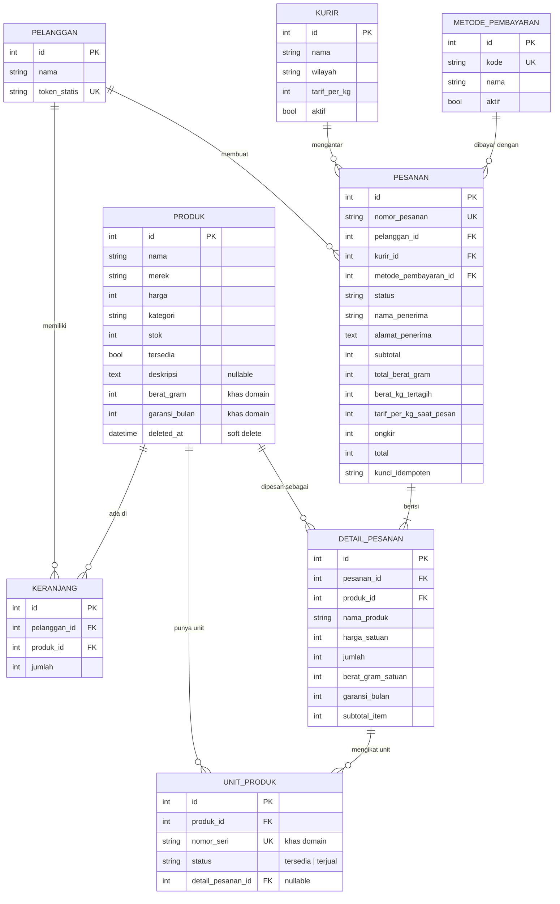

# Skema Basis Data — Zenvora

> Pendamping `prd.md`. Dokumen ini adalah sumber kebenaran untuk migrasi Laravel, seeder, model Eloquent, dan model data Dart.
> DBMS: MySQL 8.0.30 (Laragon) · Nama basis data: `zenvora` · Charset: `utf8mb4`

---

## 1. Diagram Relasi (ERD)

Diagram ini dipakai ulang sebagai Bagian 1 PDF dokumentasi API (bisa dirender di GitHub atau mermaid.live, lalu diekspor ke gambar).



Entitas yang tidak ada pada domain kelompok lain: **`unit_produk`** (nomor seri per unit fisik) dan perhitungan berat pada **`pesanan`** (`total_berat_gram`, `berat_kg_tertagih`, `tarif_per_kg_saat_pesan`).

---

## 2. Daftar Tabel dan Kolom

Konvensi: nama tabel dan kolom berbahasa Indonesia, huruf kecil, `snake_case`. Seluruh tabel punya `created_at` dan `updated_at` kecuali dinyatakan lain. Rupiah disimpan sebagai bilangan bulat (`unsignedInteger`), tanpa desimal.

> Laravel menjamakkan nama model dengan kaidah Inggris (`Produk` → `produks`). Setiap model **wajib** menulis `protected $table = 'produk';` dan seterusnya.

### 2.1 `pelanggan`

| Kolom | Tipe | Keterangan |
|-------|------|-----------|
| id | bigint unsigned PK | |
| nama | string(100) | |
| token_statis | string(64), unique | Token yang dikirim Flutter pada `Authorization: Bearer` |

Seeder: satu baris (`id = 1`, "Pembeli Zenvora", token ditulis di README). Diganti tabel pengguna + JWT pada Pertemuan 14.

### 2.2 `produk`

Tujuh kunci inti wajib dari dokumen tugas + dua kolom khas domain (+ `merek` penunjang).

| Kolom | Tipe | Keterangan |
|-------|------|-----------|
| id | bigint unsigned PK | |
| nama | string(150) | |
| merek | string(60) | Penunjang tampilan |
| harga | unsigned int | Rupiah bulat |
| kategori | string(30), index | `gadget`, `laptop`, `tv`, `monitor`, `tablet` (daftar di `config/zenvora.php`) |
| stok | unsigned int, default 0 | **Selalu sama dengan jumlah unit berstatus `tersedia`** (lihat Bagian 4) |
| tersedia | boolean, default true | Penanda aktif, terpisah dari stok |
| deskripsi | text, **nullable** | Flutter wajib menangani null |
| berat_gram | unsigned int | Khas domain, dipakai menghitung ongkir |
| garansi_bulan | unsigned smallint | Khas domain, disalin ke `detail_pesanan` |
| deleted_at | timestamp, nullable | Soft delete, agar riwayat pesanan tetap utuh |

### 2.3 `unit_produk`

Satu baris = satu barang fisik dengan nomor seri.

| Kolom | Tipe | Keterangan |
|-------|------|-----------|
| id | bigint unsigned PK | |
| produk_id | FK → produk.id | `restrict` |
| nomor_seri | string(40), **unique** | Format seeder: `ZNV-P{kodeProduk}-{urut4digit}`, mis. `ZNV-P04-0003` |
| status | string(15), default `tersedia` | `tersedia` atau `terjual` (terikat ke detail pesanan) |
| detail_pesanan_id | FK → detail_pesanan.id, **nullable** | Terisi saat unit dialokasikan ke pesanan |

Indeks: `(produk_id, status)`.

### 2.4 `keranjang`

Satu baris = satu item keranjang. `id` baris inilah yang dipakai pada `PUT/DELETE /api/keranjang/{id}`.

| Kolom | Tipe | Keterangan |
|-------|------|-----------|
| id | bigint unsigned PK | |
| pelanggan_id | FK → pelanggan.id | `cascade` |
| produk_id | FK → produk.id | |
| jumlah | unsigned int | Minimal 1 (divalidasi server, 422 bila ≤ 0) |

Unique: `(pelanggan_id, produk_id)` → menambah produk yang sudah ada hanya menaikkan `jumlah`. Keranjang **tidak mereservasi stok**; stok baru berkurang saat checkout.

### 2.5 `kurir`

| Kolom | Tipe | Keterangan |
|-------|------|-----------|
| id | bigint unsigned PK | |
| nama | string(60) | |
| wilayah | string(80) | Wilayah antar |
| tarif_per_kg | unsigned int | Rupiah per kg |
| aktif | boolean, default true | |

### 2.6 `metode_pembayaran`

| Kolom | Tipe | Keterangan |
|-------|------|-----------|
| id | bigint unsigned PK | |
| kode | string(30), unique | `tunai_di_tempat`, `transfer_manual` |
| nama | string(60) | Teks tampilan |
| aktif | boolean, default true | |

> Keputusan perlu dikonfirmasi: karena 14 endpoint wajib tidak memuat daftar metode, ada dua pilihan, yaitu (a) tambah endpoint ke-15 `GET /api/metode-pembayaran` yang **harus didokumentasikan**, atau (b) Flutter memakai dua konstanta kode. Rekomendasi: (a), supaya server tetap sumber kebenaran.

### 2.7 `pesanan`

| Kolom | Tipe | Keterangan |
|-------|------|-----------|
| id | bigint unsigned PK | |
| nomor_pesanan | string(30), **unique, nullable** | Diisi setelah insert dalam transaksi yang sama: `ZNV-YYYYMMDD-{id 5 digit}` |
| pelanggan_id | FK → pelanggan.id | |
| kurir_id | FK → kurir.id | |
| metode_pembayaran_id | FK → metode_pembayaran.id | |
| status | string(25), index | Lihat Bagian 5 |
| nama_penerima | string(100) | |
| alamat_penerima | text | |
| subtotal | unsigned int | Σ `subtotal_item` |
| total_berat_gram | unsigned int | Σ (`berat_gram_satuan` × `jumlah`) |
| berat_kg_tertagih | unsigned int | `ceil(total_berat_gram / 1000)` |
| tarif_per_kg_saat_pesan | unsigned int | **Salinan** tarif kurir saat checkout |
| ongkir | unsigned int | `berat_kg_tertagih × tarif_per_kg_saat_pesan` |
| total | unsigned int | `subtotal + ongkir` |
| kunci_idempoten | string(100) | Nilai header `X-Kunci-Idempoten` |

Unique: `(pelanggan_id, kunci_idempoten)`. Indeks: `(pelanggan_id, created_at)`.

Kolom hasil hitung disimpan **bersama** detail per item, bukan sebagai satu-satunya sumber (larangan di dokumen tugas Bagian 4).

### 2.8 `detail_pesanan`

Semua kolom bertanda "salinan" sengaja menduplikasi data produk saat pembelian agar pesanan lama tidak berubah ketika produk diedit (Kriteria 5, uji petik C3).

| Kolom | Tipe | Keterangan |
|-------|------|-----------|
| id | bigint unsigned PK | |
| pesanan_id | FK → pesanan.id | `cascade` |
| produk_id | FK → produk.id | `restrict` (produk di-soft-delete, bukan dihapus fisik) |
| nama_produk | string(150) | Salinan |
| harga_satuan | unsigned int | Salinan harga saat pembelian |
| jumlah | unsigned int | |
| berat_gram_satuan | unsigned int | Salinan |
| garansi_bulan | unsigned smallint | Salinan, tampil di rincian pesanan |
| subtotal_item | unsigned int | `harga_satuan × jumlah` |

Nomor seri unit suatu detail pesanan diambil dari `unit_produk` yang `detail_pesanan_id`-nya sama.

---

## 3. Urutan Migrasi

Urutan ini menghindari referensi melingkar (`unit_produk` merujuk `detail_pesanan`, jadi dibuat setelahnya).

1. `pelanggan`
2. `produk`
3. `kurir`
4. `metode_pembayaran`
5. `keranjang`
6. `pesanan`
7. `detail_pesanan`
8. `unit_produk`

Seeder (`DatabaseSeeder`) memanggil berurutan: Pelanggan → Kurir → MetodePembayaran → Produk (+ unit) → PesananContoh.

---

## 4. Aturan Konsistensi Stok dan Unit

**Invarian:** untuk setiap produk, `produk.stok = COUNT(unit_produk WHERE status = 'tersedia')`.

Invarian ini hanya boleh berubah **di dalam transaksi** yang juga mengubah baris unit.

| Peristiwa | Perubahan unit | Perubahan `stok` |
|-----------|----------------|------------------|
| Checkout berhasil | N unit `tersedia` → `terjual`, `detail_pesanan_id` terisi | −N |
| Checkout gagal (rollback) | tidak ada | tidak ada |
| Pesanan `dibatalkan` | unit kembali `tersedia`, `detail_pesanan_id` = null | +N |
| `POST /api/produk` dengan `stok` = N | dibuat N unit baru bernomor seri otomatis | = N |
| `PUT /api/produk/{id}` dengan `stok` = M | menambah unit, atau menghapus unit `tersedia` bila M lebih kecil; unit `terjual` tidak disentuh | = M |

**Penguncian saat checkout** (detail alur di `architecture.md`):

1. Mulai transaksi.
2. Kunci baris `produk` yang terlibat dengan `lockForUpdate()` **berurutan menurut `id` naik** (mencegah deadlock antar dua checkout).
3. Periksa `tersedia` dan jumlah unit `tersedia` cukup, kalau tidak → rollback + 409 beserta daftar item yang stoknya kurang.
4. Pilih N unit `tersedia` per item (`lockForUpdate`), ubah ke `terjual`, kurangi `stok`.
5. Simpan `pesanan` dan `detail_pesanan` (salinan harga, berat, garansi), isi `unit_produk.detail_pesanan_id`.
6. Kosongkan `keranjang` pelanggan, commit.

**Penghapusan produk:** `DELETE /api/produk/{id}` mengembalikan **409** bila produk ada pada pesanan dengan status selain `selesai` dan `dibatalkan`. Selain itu produk di-*soft delete* dan baris `keranjang` yang memuatnya ikut dihapus dalam transaksi yang sama.

**Pemeriksaan invarian** (harus mengembalikan 0 baris; jalankan setelah seeder dan setelah uji checkout):

```sql
SELECT p.id, p.nama, p.stok, COUNT(u.id) AS unit_tersedia
FROM produk p
LEFT JOIN unit_produk u ON u.produk_id = p.id AND u.status = 'tersedia'
GROUP BY p.id, p.nama, p.stok
HAVING p.stok <> COUNT(u.id);
```

---

## 5. Status Pesanan

Disimpan sebagai string; daftar nilai dan aturan perpindahan dikodekan di satu enum PHP (`StatusPesanan`) dengan metode `bolehPindahKe()`.

| Dari | Boleh ke |
|------|----------|
| `menunggu_pembayaran` | `menunggu_konfirmasi`, `dibatalkan` |
| `menunggu_konfirmasi` | `dibayar`, `dibatalkan` |
| `dibayar` | `diproses` |
| `diproses` | `dikirim` |
| `dikirim` | `selesai` |
| `selesai`, `dibatalkan` | (akhir, tidak ada) |

Perpindahan di luar tabel → **409**. Pembatalan mengembalikan unit dan stok (Bagian 4).

---

## 6. Perhitungan yang Hanya Terjadi di Server

```
subtotal_item     = harga_satuan × jumlah
subtotal          = Σ subtotal_item
total_berat_gram  = Σ (berat_gram_satuan × jumlah)
berat_kg_tertagih = ceil(total_berat_gram / 1000)
ongkir            = berat_kg_tertagih × tarif_per_kg_saat_pesan
total             = subtotal + ongkir
```

Contoh: 1 laptop 1.400 g + 1 tablet 510 g = 1.910 g → 2 kg; kurir "Zenvora Jawa" 7.500/kg → ongkir 15.000.

---

## 7. Data Seeder

Seluruh nama, harga, dan berat di bawah adalah **data contoh**, boleh diubah. Syarat dokumen tugas: ≥ 12 produk di ≥ 2 kategori, ≥ 2 produk berstok nol, 3 kurir bertarif berbeda, 2 metode bayar, 3 pesanan contoh berstatus berbeda.

### 7.1 Produk (15)

| # | Kategori | Nama contoh | Harga | Berat (g) | Garansi (bln) | Unit awal | Catatan |
|---|----------|-------------|------:|----------:|--------------:|----------:|---------|
| 1 | gadget | Samsung Galaxy A55 5G 8/256 | 5.999.000 | 213 | 12 | 5 | |
| 2 | gadget | Xiaomi Redmi Note 13 Pro | 4.299.000 | 187 | 12 | 8 | |
| 3 | gadget | Apple iPhone 15 128GB | 12.999.000 | 171 | 12 | 0 | **stok nol** |
| 4 | laptop | ASUS Vivobook 14 | 8.499.000 | 1.400 | 24 | 4 | |
| 5 | laptop | Lenovo IdeaPad Slim 3 | 7.199.000 | 1.620 | 24 | 6 | |
| 6 | laptop | Acer Aspire 5 | 9.299.000 | 1.700 | 24 | 3 | |
| 7 | tv | Samsung 43" Crystal UHD | 5.499.000 | 9.500 | 12 | 3 | |
| 8 | tv | LG 50" 4K Smart TV | 6.999.000 | 12.500 | 12 | 2 | |
| 9 | tv | TCL 32" HD Android TV | 1.899.000 | 4.200 | 12 | 0 | **stok nol** |
| 10 | monitor | LG 24" Full HD | 1.649.000 | 3.300 | 24 | 7 | |
| 11 | monitor | Dell 24" Full HD | 1.799.000 | 3.600 | 36 | 5 | |
| 12 | monitor | Samsung 27" Curved 144Hz | 3.499.000 | 5.500 | 24 | 2 | `tersedia = false` (menguji kolom terpisah dari stok) |
| 13 | tablet | Samsung Galaxy Tab A9+ | 3.199.000 | 510 | 12 | 6 | |
| 14 | tablet | Xiaomi Pad 6 | 4.999.000 | 490 | 12 | 4 | |
| 15 | tablet | Apple iPad 10th Gen | 7.999.000 | 477 | 12 | 3 | |

Setiap produk punya `deskripsi`, **kecuali dua** (mis. #9 dan #12) yang dibiarkan `NULL` agar penanganan null di Flutter bisa didemonstrasikan.

### 7.2 Kurir (3), tarif berbeda

| Nama | Wilayah | Tarif/kg |
|------|---------|---------:|
| Zenvora Kota | Sidoarjo dan Surabaya | 4.000 |
| Zenvora Jawa | Jawa Timur lainnya | 7.500 |
| Zenvora Nusantara | Luar Jawa Timur | 15.000 |

(Nama dan tarif adalah usulan; masih termasuk pertanyaan terbuka di PRD.)

### 7.3 Metode pembayaran (2)

| kode | nama |
|------|------|
| `tunai_di_tempat` | Bayar Tunai di Tempat |
| `transfer_manual` | Transfer Manual |

### 7.4 Pesanan contoh (3)

Dibuat oleh seeder **lewat logika yang sama dengan checkout** (bukan `INSERT` mentah), agar stok, unit, dan invarian tetap benar.

| # | Isi | Status |
|---|-----|--------|
| A | 1× Redmi Note 13 Pro + 1× Galaxy Tab A9+ | `menunggu_pembayaran` |
| B | 1× ASUS Vivobook 14 | `dibayar` |
| C | 2× LG 24" Full HD | `selesai` |

Stok akhir setelah seeder: Redmi 7, Tab A9+ 5, Vivobook 3, LG 24" 5 (selebihnya sama dengan "Unit awal").

### 7.5 Perintah verifikasi

```bash
php artisan migrate:fresh --seed
```

Harus selesai dalam sekali jalan di komputer bersih, lalu jalankan SQL invarian Bagian 4 (hasil: 0 baris).

---

## 8. Pemetaan ke JSON dan Model Dart

Objek produk pada respons (tipe sesuai dokumen tugas):

```json
{
  "id": 4,
  "nama": "ASUS Vivobook 14",
  "merek": "ASUS",
  "harga": 8499000,
  "kategori": "laptop",
  "stok": 3,
  "tersedia": true,
  "deskripsi": null,
  "berat_gram": 1400,
  "garansi_bulan": 24
}
```

Di Dart: `harga`, `stok`, `berat_gram`, `garansi_bulan` bertipe `int`; `tersedia` `bool`; `deskripsi` `String?`.

Objek item pada `GET /api/pesanan/{id}` memakai kolom `detail_pesanan` (nama, harga saat beli, jumlah, garansi) ditambah `nomor_seri` berupa array string dari unit yang terikat.

---

## 9. Keputusan Rancangan yang Perlu Disepakati

1. Endpoint ke-15 `GET /api/metode-pembayaran` (Bagian 2.6).
2. `PUT /api/produk` dengan `stok` bertindak sebagai **target jumlah unit** (default). Alternatif yang lebih sederhana: `PUT` mengabaikan `stok`, dan stok hanya bertambah lewat `POST`.
3. Soft delete pada `produk` (default) agar riwayat pesanan utuh.
4. Pembatalan pesanan mengembalikan stok (default).
5. Tabel log perubahan status (`riwayat_status`) **tidak dibuat** dulu; bisa ditambahkan jika waktu tersisa.
